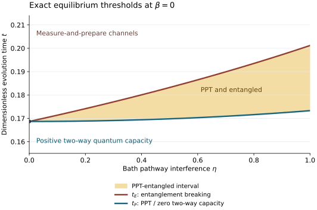

# Bath Interference Bound Entanglement

**Can an equilibrium bath erase quantum communication before it erases every possible input–reference entanglement, while leaving population relaxation unchanged?** This project gives an explicit four-level Davies model in which interference between equal-frequency transition pathways does exactly that.

The bath-interference parameter $`0\le\eta\le1`$ changes coherence transfer while preserving the entire classical population generator and every bare coherence self-damping coefficient. The Hamiltonian has distinct energy levels and repeated Bohr frequencies. Every generator obeys quantum detailed balance with a faithful Gibbs state; no driving or stationary population current is required.

## Exact entanglement lifetimes

At infinite temperature, define

```math
r=e^{-8t},\qquad
u=e^{-(10-2\eta)t},\qquad
v=e^{-(10+2\eta)t}.
```

The exact PPT time $`t_P`$ and entanglement-breaking time $`t_E`$ are the unique roots

```math
r+2u+2v=1\quad\text{at }t=t_P,
\qquad
r+4u=1\quad\text{at }t=t_E.
```

For **every positive interference** $`\eta>0`$, these times differ:

| Noise duration | Channel behavior | Two-way assisted quantum capacity |
|---|---|---|
| $`0\le t\lt t_P`$ | The Choi state has an explicitly distillable two-qubit projection | Strictly positive |
| $`t_P\le t\lt t_E`$ | The Choi state is PPT and entangled; the channel is not measure-and-prepare | Zero |
| $`t\ge t_E`$ | The channel is entanglement breaking and admits a measure-and-prepare description | Zero |

The middle interval contains bound entanglement between an untouched reference and the noisy system. It collapses when the bath fully distinguishes the pathways, $`\eta=0`$. Near that endpoint its width grows linearly in interference, while the PPT time first changes quadratically. The entire interpolation also has the same infinite-temperature dissipative spectral gap.

At maximal interference,

```math
t_P(1)=\frac{\log2}{4}\approx0.173287,
\qquad
t_E(1)=\frac{\log5}{8}\approx0.201180.
```

Time is measured in units of the common dissipative rate; [the model](science/model.md) specifies the physical scales. The [exact proof](science/exact_thresholds.md) combines a partial-transpose spectrum, a Breuer–Hall entanglement witness and a constructive mixture of twenty elementary EB channels.



## A finite-temperature certificate

The effect also occurs at strictly positive inverse temperature. At $`\beta=10^{-4}`$, $`\eta=1`$ and

```math
t_* = \frac14\log\frac{25}{12},
```

an analytical norm bound certifies a strictly PPT, non-entanglement-breaking channel. The proof uses exact rational spectral margins and establishes a neighborhood of admissible generators and times. It does not assume that the infinite-temperature threshold formulas remain exact at finite temperature. See [the thermal extension](science/thermal_extension.md).

## Read the science

Start with the [scientific overview and definitions](science/README.md), then follow the model, threshold proof and operational interpretation.

| Question | Authoritative account |
|---|---|
| Which bath correlations change, and why do populations stay fixed? | [Model and detailed balance](science/model.md) |
| Why are both threshold times exact? | [PPT spectrum and constructive EB proof](science/exact_thresholds.md) |
| Why is the earlier boundary exactly the loss of positive two-way quantum capacity? | [Local filtering and adaptive PPT obstruction](science/operational_meaning.md) |
| Does the mechanism survive away from infinite temperature? | [Rigorous thermal certificate](science/thermal_extension.md) |
| What do repeated gaps, detuning and the comparison with resolved jumps mean physically? | [Interpretation and scope](science/interpretation.md) |
| Which ingredients and nearby phenomena were already known? | [Related work](references/RELATED_WORK.md) and [bibliography](references/references.bib) |
| How can the finite calculations be reproduced? | [Verification](verification/README.md) |

The [LLM reading guide](llms.txt) maps scientific questions to these files. Known symplectic channel geometry supplies the fully interfering endpoint, and generic noise-induced bound entanglement is established prior work. The contribution developed here is the matched equilibrium bath family and its exact dynamical boundaries throughout the interference interpolation.

## Learn the project

The educational anchor is **Ángel Rivas and Susana F. Huelga, *Open Quantum Systems: An Introduction*, first edition (2012)**. The [Rivas–Huelga bridge](learning/RIVAS_HUELGA_BRIDGE.md) maps its treatment of dynamical maps, Markov generators and thermal frequency blocks to this model. It translates the notation and supplies the route from reservoir dynamics to the Choi-state, positive-map and communication arguments used here.

The [30-milestone map](learning/MILESTONES.md) develops **14 background/preliminaries milestones** followed by **16 narrative/innovation milestones**. The first phase joins the open-system and referenced-channel viewpoints; the second follows the bath mechanism through the exact boundaries, operational meaning and thermal continuation. Each milestone gives its question, understanding target, earlier dependencies, conceptual connection and source pointers.

The [learning entrypoint](learning/README.md) connects the bridge, milestone map and specialist proofs. The book's published chapter numbers and the corrected author preprint's section numbers differ; the bridge identifies which source each pointer uses.

## Reproduce the checks

From the repository root:

```bash
python3 -m pip install -r verification/requirements.txt
python3 verification/run_all.py
```

The suite constructs the Lindblad superoperator directly from its matrix jumps and compares it with the analytical Pauli solution. It checks thermal stationarity and detailed balance, population matching, Choi and partial-transpose spectra, the EB decomposition, the two-qubit filtering certificate and the finite-temperature example. The [verification instructions](verification/README.md) distinguish these finite checks from the general analytical proofs and document the plot.

## Scope

The exact all-interference formulas hold at infinite temperature; positive-temperature persistence has a separate rigorous certificate. The bath cross-correlations have a specified sign pattern and join exactly equal-frequency transitions. Arbitrary Hamiltonian detuning followed by a new fully secular limit is not a small perturbation of that construction. The result identifies the sign of two-way quantum capacity, not its value or the unassisted capacity. The current model is a mathematical thermal-reservoir realization; no platform-specific implementation or minimum-dimension claim is assumed.

## Purpose and contact

This repository serves as a record of the work and a guide for the author’s self-directed learning. For discussion or potential collaboration, please contact Ruge Lin at [gogoko699@gmail.com](mailto:gogoko699@gmail.com).
