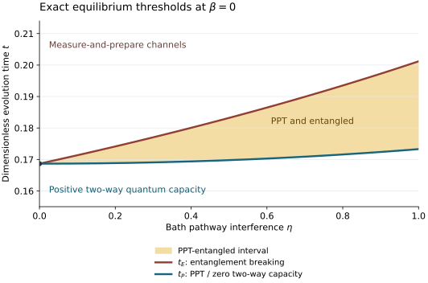

# Exact PPT and entanglement-breaking thresholds

For the four-level Davies family defined in [the model](model.md), the infinite-temperature channel has two exactly computable thresholds. Write $`\Phi_{\eta,t}=\exp(t\mathcal L_{0,\eta})`$, with $`0\leq\eta\leq1`$ and $`t\geq0`$. The time coordinate uses the dissipative rate normalization in the model.

```math
\boxed{
\begin{aligned}
\Phi_{\eta,t}\text{ is PPT}
&\Leftrightarrow e^{-8t}+4e^{-10t}\cosh(2\eta t)\leq1,\\
\Phi_{\eta,t}\text{ is entanglement breaking}
&\Leftrightarrow e^{-8t}+4e^{-(10-2\eta)t}\leq1.
\end{aligned}}
```

At $`\eta=0`$ the thresholds coincide. Every $`\eta>0`$ opens a nonempty interval of PPT channels whose Choi states remain entangled. The proof below supplies both a positive-map witness and a convex decomposition into explicit measure-and-prepare channels. The [operational account](operational_meaning.md) proves that the PPT threshold is also the exact positivity boundary of two-way-assisted quantum capacity.

These formulas concern $`\beta=0`$. A strictly positive inverse-temperature example is established separately in the [thermal extension](thermal_extension.md). Adding the specified commuting Hamiltonian evolution leaves the thresholds unchanged; arbitrary additional diagonal Hamiltonian terms are outside this exact calculation.

## 1. Solving the generator

Use computational basis order $`00,01,10,11`$, matrix units $`E_{ij}=\lvert i\rangle\langle j\rvert`$, and the Pauli convention $`XY=X\otimes Y`$. The system Hamiltonian is $`H=\mathrm{diag}(4,2,-4,-2)`$.

### 1.1 Populations

At $`\beta=0`$, the population vector is a column vector and satisfies $`\dot p=Qp`$, where

```math
Q=
\begin{pmatrix}
-8&2&4&2\\
2&-8&2&4\\
4&2&-8&2\\
2&4&2&-8
\end{pmatrix}.
```

This follows directly from the frequency-resolved jump blocks in the model: the transitions $`0\leftrightarrow1`$, $`2\leftrightarrow3`$, $`0\leftrightarrow3`$, and $`1\leftrightarrow2`$ have rate $`2`$, while $`0\leftrightarrow2`$ and $`1\leftrightarrow3`$ have rate $`4`$. The interference terms do not act on diagonal matrices.

The diagonal Pauli eigenoperators consequently satisfy

```math
\mathcal L_{0,\eta}(II)=0,\qquad
\mathcal L_{0,\eta}(IZ)=-8IZ,\qquad
\mathcal L_{0,\eta}(ZI)=-12ZI,\qquad
\mathcal L_{0,\eta}(ZZ)=-12ZZ.
```

### 1.2 Coherences

The common outgoing population rate is $`8`$. The zero-frequency jumps $`ZI`$ and $`ZZ`$ add either $`2`$ or $`4`$ to the damping of an off-diagonal matrix unit. The only nontrivial coherence-transfer blocks are

```math
\begin{aligned}
\mathcal L_{0,\eta}(E_{01})&=-10E_{01}+2\eta E_{32},&
\mathcal L_{0,\eta}(E_{32})&=-10E_{32}+2\eta E_{01},\\
\mathcal L_{0,\eta}(E_{03})&=-10E_{03}-2\eta E_{12},&
\mathcal L_{0,\eta}(E_{12})&=-10E_{12}-2\eta E_{03},
\end{aligned}
```

together with their Hermitian adjoints. The remaining coherences $`E_{02},E_{20},E_{13},E_{31}`$ have decay rate $`12`$.

For example, the positive off-diagonal Kossakowski coefficient at frequency $`6`$ produces $`E_{03}E_{32}E_{21}=E_{01}`$. Its reverse-frequency partner produces the reverse transfer. The negative coefficient at frequency $`2`$ similarly couples $`E_{03}`$ and $`E_{12}`$ with the opposite sign. These are transfers between equal-frequency coherences; the self-damping coefficients remain independent of $`\eta`$.

Diagonalizing these two-by-two blocks gives the complete Pauli solution. Define

```math
r=e^{-8t},\qquad
u=e^{-(10-2\eta)t},\qquad
v=e^{-(10+2\eta)t},\qquad
b=e^{-12t}.
```

| Pauli eigenoperators | Channel multiplier | Generator decay rate |
|---|---|---|
| $`II`$ | $`1`$ | $`0`$ |
| $`IZ`$ | $`r`$ | $`8`$ |
| $`IX,XY,YY,ZY`$ | $`u`$ | $`10-2\eta`$ |
| $`IY,XX,YX,ZX`$ | $`v`$ | $`10+2\eta`$ |
| $`XI,XZ,YI,YZ,ZI,ZZ`$ | $`b`$ | $`12`$ |

For instance, $`IX`$ and $`ZY`$ use the symmetric combinations of $`E_{01},E_{32}`$ and their adjoints, whereas $`IY`$ and $`ZX`$ use the antisymmetric combinations. The other transfer block gives the remaining $`u`$ and $`v`$ modes. Thus the table follows directly from the jump generator, with no assumption about Choi-state symmetry.

Throughout the parameter range,

```math
1\geq r\geq u\geq v\geq b>0.
```

The dissipative spectral gap is exactly $`8`$ for every $`\eta\in[0,1]`$. The full coherence eigenmode rates change even though the population generator, matrix-unit self-damping coefficients, and this gap remain fixed.

## 2. Exact PPT criterion

Use the normalized maximally entangled vector and Choi state

```math
\lvert\Omega_4\rangle=\frac12\sum_{i=0}^{3}\lvert i,i\rangle,
\qquad
J_{\eta,t}=(\mathrm{id}\otimes\Phi_{\eta,t})
(\lvert\Omega_4\rangle\langle\Omega_4\rvert).
```

Orthogonality of the two-qubit Pauli basis gives

```math
J_{\eta,t}=\frac1{16}\sum_P\lambda_P P^T\otimes P,
\qquad
J_{\eta,t}^{\Gamma}=\frac1{16}\sum_P\lambda_P P\otimes P.
```

Here $`\Gamma`$ transposes the output factor. In the second equality, the two transpose signs cancel for each Pauli. All operators $`P\otimes P`$ commute: any anticommutation sign appears twice.

For an explicit diagonalization, let $`\lvert Q\rangle\!\rangle=\sum_{ij}Q_{ij}\lvert i,j\rangle`$. The sixteen vectors $`\lvert Q\rangle\!\rangle/2`$, with $`Q`$ ranging over the Pauli basis, are orthonormal. The identity

```math
(P\otimes P)\lvert Q\rangle\!\rangle
=\lvert PQP^T\rangle\!\rangle
```

reduces the spectrum to Pauli multiplication signs. The complete result is:

| Pauli labels $`Q`$ of eigenvectors | Eigenvalue of $`16J_{\eta,t}^{\Gamma}`$ | Multiplicity |
|---|---|---|
| $`II,IZ,XI,XZ,ZI,ZZ`$ | $`1+r+2b`$ | 6 |
| $`IX,XX,YY,ZX`$ | $`1-r+2u+2v`$ | 4 |
| $`IY,XY,YX,ZY`$ | $`1-r-2u-2v`$ | 4 |
| $`YI`$ | $`1+r-6b+4(u-v)`$ | 1 |
| $`YZ`$ | $`1+r-6b-4(u-v)`$ | 1 |

The smallest eigenvalue is

```math
\lambda_{\min}(J_{\eta,t}^{\Gamma})
=\frac{1-r-2u-2v}{16}.
```

Indeed, the difference between the last entry and $`1-r-2u-2v`$ is $`2(r-u)+6(v-b)\geq0`$; the preceding entry is no smaller, and the first two entries are also larger. Since the generator is Lindblad, complete positivity of the channel is already assured. Therefore

```math
\Phi_{\eta,t}\text{ is PPT}
\Leftrightarrow r+2u+2v\leq1.
```

## 3. An entanglement witness up to the EB boundary

The Breuer–Hall map on four-dimensional matrices is

```math
\mathcal B(X)=\mathrm{Tr}(X)I-X-VX^TV^\dagger,
\qquad V=YI,\qquad V^T=-V.
```

Its positivity has a short direct proof. For every unit vector $`\psi`$, skew-symmetry gives $`\langle\psi,V\overline\psi\rangle=0`$. Thus $`\mathcal B(\lvert\psi\rangle\langle\psi\rvert)`$ is the identity minus two orthogonal rank-one projections and is positive. A positive combination of rank-one projectors proves positivity on every positive matrix. Applying $`\mathrm{id}\otimes\mathcal B`$ to a separable state must consequently preserve positivity. This witness construction is due to [Breuer (2006)](https://doi.org/10.1103/PhysRevLett.97.080501) and [Hall (2006)](https://doi.org/10.1088/0305-4470/39/45/020).

Because the channel is trace preserving, $`\mathrm{Tr}_{\rm out}J=I/4`$, so

```math
(\mathrm{id}\otimes\mathcal B)(J)
=\frac{I_{16}}4-J-(I\otimes V)J^\Gamma(I\otimes V^\dagger).
```

The vector $`\Omega_4`$ is an eigenvector of this operator with eigenvalue

```math
w(\eta,t)=\frac{1-r-4u}{8}.
```

To verify the expression, $`\Omega_4`$ has $`J`$ eigenvalue $`(1+r+4u+4v+6b)/16`$. The vector $`(I\otimes V^\dagger)\Omega_4`$ is, up to phase, the partial-transpose eigenvector labeled $`YI`$ in the preceding table. Subtracting its eigenvalue from $`1/4`$ and the first eigenvalue yields $`w(\eta,t)`$.

Hence

```math
r+4u>1\quad\Longrightarrow\quad
J_{\eta,t}\text{ is entangled}\quad\Longrightarrow\quad
\Phi_{\eta,t}\text{ is not entanglement breaking}.
```

## 4. A constructive EB decomposition at the boundary

Let $`t_E=t_E(\eta)`$ be the unique positive root of $`r+4u=1`$. Every coefficient in this section is evaluated at that time.

### 4.1 Two explicit measure-and-prepare channels

For a nonidentity two-qubit Pauli $`g`$, let $`\Pi_{g,\pm}=(I\pm g)/2`$. Each projector has rank two. Define the **singleton channel**

```math
\mathcal S_g(X)
=\sum_{s=\pm1}\mathrm{Tr}(\Pi_{g,s}X)\frac{\Pi_{g,s}}2
=\frac14\bigl[\mathrm{Tr}(X)I+\mathrm{Tr}(gX)g\bigr].
```

This is a trace-preserving measure-and-prepare map: the measurement projectors sum to $`I`$, and each prepared state $`\Pi_{g,s}/2`$ has unit trace. It retains the Pauli coefficients of $`I`$ and $`g`$ and erases every other coefficient. The normalized mixed preparation within each rank-two eigenspace is essential. Eigenspace pinching alone has different coefficients and preserves quantum information within each eigenspace.

For independent commuting Paulis $`g,h`$, let

```math
\Pi_{s,t}=\frac14(I+sg)(I+th),\qquad s,t\in\{+1,-1\}.
```

These are four mutually orthogonal rank-one projectors. The **triple channel**

```math
\mathcal T_{g,h}(X)
=\sum_{s,t}\mathrm{Tr}(\Pi_{s,t}X)\Pi_{s,t}
```

is complete dephasing in their joint eigenbasis, hence also trace preserving and entanglement breaking. It retains exactly $`I,g,h,gh`$. If $`gh=-k`$ for the chosen unsigned Pauli representative $`k`$, the retained coefficient of $`k`$ is still one. Thus a commuting triple can be specified by its three unsigned Pauli labels.

### 4.2 All twenty components

Choose the five mutually anticommuting Pauli operators

```math
\Gamma_0=IZ,\qquad
\Gamma_1=IX,\qquad
\Gamma_2=XY,\qquad
\Gamma_3=YY,\qquad
\Gamma_4=ZY.
```

The other ten nonidentity Paulis are their bivectors $`i\Gamma_a\Gamma_b`$, up to signs. Put

```math
a_0=r-3b+2v,\qquad
a_1=u-v,\qquad
c_0=b-\frac{2v}{3},\qquad
c_1=\frac v3.
```

The proposed channel is the mixture of the following twenty EB components. Each row is one channel, with its displayed weight.

| Component | Weight |
|---|---|
| Singleton $`IZ`$ | $`a_0`$ |
| Singleton $`IX`$ | $`a_1`$ |
| Singleton $`XY`$ | $`a_1`$ |
| Singleton $`YY`$ | $`a_1`$ |
| Singleton $`ZY`$ | $`a_1`$ |
| Triple $`IZ,XI,XZ`$ | $`c_0`$ |
| Triple $`IZ,YI,YZ`$ | $`c_0`$ |
| Triple $`IZ,ZI,ZZ`$ | $`c_0`$ |
| Triple $`IX,XI,XX`$ | $`c_1`$ |
| Triple $`IX,YI,YX`$ | $`c_1`$ |
| Triple $`IX,ZI,ZX`$ | $`c_1`$ |
| Triple $`IY,XI,XY`$ | $`c_1`$ |
| Triple $`XY,YX,ZZ`$ | $`c_1`$ |
| Triple $`XY,YZ,ZX`$ | $`c_1`$ |
| Triple $`IY,YI,YY`$ | $`c_1`$ |
| Triple $`XX,YY,ZZ`$ | $`c_1`$ |
| Triple $`XZ,YY,ZX`$ | $`c_1`$ |
| Triple $`IY,ZI,ZY`$ | $`c_1`$ |
| Triple $`XX,YZ,ZY`$ | $`c_1`$ |
| Triple $`XZ,YX,ZY`$ | $`c_1`$ |

### 4.3 Why the mixture reproduces the channel

Each nonidentity two-qubit Pauli commutes with six other nonidentity Paulis. They pair into three maximal commuting triples. There are therefore fifteen triples in total, and each Pauli occurs in three of them.

No triple contains two of the five $`\Gamma_a`$, because they anticommute. Their fifteen total incidences consequently place exactly one $`\Gamma_a`$ in every triple. Three triples contain $`\Gamma_0`$ and twelve contain another gamma.

A bivector $`i\Gamma_a\Gamma_b`$ anticommutes with $`\Gamma_a,\Gamma_b`$ and commutes with the other three gammas. Each of those three commuting gammas supplies one of the bivector's three triples. Thus:

- The $`IZ`$ coefficient is $`a_0+3c_0=r`$.
- Each other gamma coefficient is $`a_1+3c_1=u`$.
- A bivector involving $`\Gamma_0`$ occurs in three $`c_1`$ triples, giving $`3c_1=v`$.
- A bivector not involving $`\Gamma_0`$ occurs in one $`c_0`$ triple and two $`c_1`$ triples, giving $`c_0+2c_1=b`$.

The identity coefficient is the total mixture weight,

```math
a_0+4a_1+3c_0+12c_1=r+4u=1.
```

The Pauli operators form a basis, so equality of these coefficients proves equality of the complete channels.

### 4.4 Nonnegative weights

The ordering $`r\geq u\geq v\geq b`$ gives $`a_1\geq0`$, $`c_1>0`$, and

```math
a_0=r-3b+2v\geq r-b\geq0.
```

For $`c_0`$, first note that $`u\leq r`$. At the root,

```math
1=r+4u\leq5e^{-8t_E},
\qquad t_E\leq\frac{\log5}{8}.
```

It follows that

```math
\frac vb=e^{2(1-\eta)t_E}
\leq e^{2t_E}\leq5^{1/4}\lt \frac32,
```

so $`c_0=b-2v/3>0`$. All twenty weights are therefore nonnegative. The mixture is an explicit trace-preserving EB channel, proving that $`\Phi_{\eta,t_E}`$ is EB.

For $`t\geq t_E`$, semigroup composition gives $`\Phi_{\eta,t}=\Phi_{\eta,t-t_E}\circ\Phi_{\eta,t_E}`$. Postprocessing a measure-and-prepare channel by any quantum channel remains measure-and-prepare. Combining this sufficiency argument with the witness from Section 3 proves the exact EB criterion stated at the beginning.

## 5. Threshold ordering and weak-interference behavior

Both defining left-hand sides start at $`5`$, tend to zero, and decrease strictly in time. Therefore each threshold is a unique positive root.

At $`\eta=0`$, $`u=v`$ and both roots equal $`t_0`$, defined by

```math
e^{-8t_0}+4e^{-10t_0}=1,
\qquad t_0=0.168661984262\ldots .
```

For $`\eta>0`$, evaluate the witness at PPT onset:

```math
w(\eta,t_P)=-\frac{u-v}{4}\lt 0.
```

Thus $`t_P(\eta)\lt t_E(\eta)`$, and the entire half-open interval $`[t_P,t_E)`$ consists of PPT-entangled Choi states. The PPT endpoint is included; the EB endpoint is excluded.

Both thresholds increase with interference. Implicit differentiation gives

```math
\frac{dt_E}{d\eta}
=\frac{8t_Eu}{8r+4(10-2\eta)u}>0,
```

and, with the coefficients evaluated at $`t_P`$,

```math
\frac{dt_P}{d\eta}
=\frac{4t_P(u-v)}{8r+2(10-2\eta)u+2(10+2\eta)v}.
```

The latter derivative is positive for $`\eta>0`$ and vanishes at zero. Put $`s_0=e^{-10t_0}`$. Analytic implicit differentiation around zero yields

```math
\begin{aligned}
t_P(\eta)
&=t_0+\frac{t_0^2s_0}{1+s_0}\eta^2+O(\eta^4),\\
t_E(\eta)
&=t_0+\frac{t_0s_0}{1+s_0}\eta+O(\eta^2),\\
t_E(\eta)-t_P(\eta)
&=\frac{t_0s_0}{1+s_0}\eta+O(\eta^2).
\end{aligned}
```

The absence of odd terms in $`t_P`$ follows from the even $`\cosh`$ dependence and uniqueness of the analytic root. The binding interval therefore opens linearly while the PPT onset first moves quadratically.

At fully coherent pathway coupling,

```math
t_P(1)=\frac{\log2}{4},\qquad
t_E(1)=\frac{\log5}{8}.
```

The first identity follows by setting $`x=e^{-4t}`$ in $`3x^2+2x^3=1`$; its unique root in $`(0,1)`$ is $`x=1/2`$. The second follows from $`r=u`$.



The [verification suite](../verification/README.md) reconstructs the Lindblad superoperator independently, checks the displayed spectra and projection, and constructs the twenty component channels from their actual POVMs and prepared states. The [related-work account](../references/RELATED_WORK.md) separates this interpolation and its physical mechanism from the known static symplectic endpoint geometry.
