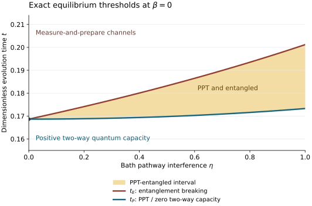

# Reproducing the finite-dimensional checks

The analytical results are proved in [exact_thresholds.md](../science/exact_thresholds.md), [operational_meaning.md](../science/operational_meaning.md), and [thermal_extension.md](../science/thermal_extension.md). This directory supplies a small independent numerical reconstruction of the physical generator and the concrete channels used in those proofs.

## Run the checks

Use Python 3.11 or later. From the repository root:

```bash
python -m pip install -r verification/requirements.txt
python verification/run_all.py
```

Only NumPy and SciPy are required. No network access is used by the verification program itself. It needs no optimization solver, symbolic algebra, or plotting library. A failed check raises an exception and exits with a nonzero status.

The command writes:

- [results/verification.json](results/verification.json): parameters, software versions, residuals, commuting triples, thermal certificates, and illustrative distillation rates.
- [results/thresholds.csv](results/thresholds.csv): threshold values and EB reconstruction checks.

The checked reference run used Python 3.12.14, NumPy 2.3.5, and SciPy 1.17.0. It passed 34 check families on nine interference values and three inverse temperatures. Its largest absolute residual was approximately $`7.8\times10^{-15}`$, below the declared $`5\times10^{-11}`$ tolerance. Last-digit floating-point differences across supported platforms are expected; the program checks numerical tolerances rather than byte-identical output.

## What is independently reconstructed

Two separate representations of the same generator are implemented in [lindblad_model.py](lindblad_model.py):

1. The ten explicit Hermitian Pauli couplings are split into their Bohr-frequency components. The resolved/coherent interpolation and KMS weights are then applied to the resulting jump matrices.
2. The small signed Kossakowski blocks at frequencies $`2,4,6,8`$ are assembled directly, together with the two diagonal dephasing jumps.

The program compares these full superoperators, constructs their matrix exponentials, and assembles normalized Choi states by applying the channel to all sixteen matrix units. The separately implemented expressions in [exact_formulas.py](exact_formulas.py) are predictions to be checked against this construction. In particular, the matrix exponential is not generated from the claimed Pauli eigenvalues.

The checks cover:

| Object | Direct check |
|---|---|
| Physical generator | Equality of the Bohr-component and Kossakowski constructions; trace preservation; covariance with the specified Hamiltonian |
| Equilibrium structure | Gibbs stationarity and GNS detailed balance at the sampled inverse temperatures |
| Matched classical data | Equality of the full population generator and of matrix-unit self-damping coefficients across $`\eta`$ |
| Relaxation gap | Direct diagonalization gives gap $`8`$ at $`\beta=0`$ |
| Exact solution | All Pauli multipliers and the complete normalized Choi expansion agree with the matrix exponential |
| PPT boundary | All sixteen partial-transpose eigenvalues agree, including the fixed rank-two eigenvector |
| Entanglement witness | The Breuer–Hall eigenvector and its negative eigenvalue agree with direct matrix evaluation |
| EB sufficiency | Actual POVMs and normalized prepared states construct all twenty component channels; their convex mixture equals the full physical channel at $`t_E`$ |
| Operational projection | The local two-qubit block, success probability, normalized state, and partial-transpose eigenvalue agree |
| Positive-rate protocol | Recurrence and hashing give a positive illustrative rate at sampled pre-threshold times |
| Positive inverse temperature | The analytic perturbation margins remain positive at $`\beta=10^{-4}`$ and agree with direct matrix checks |

The EB test is stronger than checking a table of multipliers: each singleton and triple map is built from its measurement projectors and prepared density matrices. Trace preservation, complete positivity, retained Pauli coefficients, mixture weights, and equality with the original channel are checked separately. This catches an incorrect rank-two preparation normalization, which would invalidate the constructive proof.

## Representative threshold values

Time is dimensionless in the model's normalization, with population transition rates $`2`$ or $`4`$ at $`\beta=0`$.

| Interference $`\eta`$ | PPT onset $`t_P`$ | EB onset $`t_E`$ | Width $`t_E-t_P`$ |
|---|---|---|---|
| 0 | 0.168661984262 | 0.168661984262 | 0 |
| 0.25 | 0.168940412460 | 0.175573824222 | 0.006633411761 |
| 0.5 | 0.169783925690 | 0.183207003220 | 0.013423077530 |
| 0.75 | 0.171217870451 | 0.191688917710 | 0.020471047259 |
| 1 | 0.173286795140 | 0.201179739054 | 0.027892943914 |

The weak-interference coefficients from the proof are

```math
t_P(\eta)=t_0+0.004443994305\ldots\,\eta^2+O(\eta^4),
\qquad
t_E(\eta)-t_P(\eta)=0.026348523789\ldots\,\eta+O(\eta^2).
```

## Positive-temperature reference point

At $`\eta=1`$, $`\beta=10^{-4}`$, and $`t_*=\log(25/12)/4`$, the analytic bound evaluates to

```math
\delta=52t_*(e^{4\beta}-1)
=0.003817403140\ldots .
```

Subtracting this perturbation from the zero-$`\beta`$ PPT gap leaves the certified lower margin $`0.001658596860\ldots>0`$. Subtracting twice the perturbation from the Breuer–Hall negative margin leaves $`0.011365193720\ldots>0`$. The [thermal proof](../science/thermal_extension.md) supplies the norm inequalities that make these margins rigorous; the script evaluates them and cross-checks the finite matrices.

The JSON also reports a direct matrix example at $`\beta=0.1`$. It is explicitly labeled a numerical observation and does not enlarge the proved temperature range or establish exact finite-temperature thresholds.

## Regenerate the figure

Plotting is optional and adds only Matplotlib:

```bash
python -m pip install -r verification/requirements-plot.txt
python verification/plot_thresholds.py
```

Run the verification command first. The plot script requires its passing results file and uses the same exact scalar threshold functions. It writes [figures/thresholds.svg](../figures/thresholds.svg) and [figures/thresholds.png](../figures/thresholds.png). The plot shows the neighborhood of the two thresholds; the vertical axis begins at $`t=0.155`$.



## Limits of these checks

Finite samples do not prove a statement for every $`\eta`$, every time, or every temperature. Those quantifiers follow from the analytical identities, convex decomposition, monotonicity arguments, and perturbation inequalities in the scientific pages. The program uses ordinary double-precision linear algebra, not interval arithmetic or a formal proof assistant.

The illustrative distillation rates certify positivity in the sampled pre-PPT regime; they are not capacity values or optimized lower bounds. The suite does not claim generic Hamiltonian-detuning robustness, a fixed-positive-temperature law for every interference value, an unassisted capacity formula, or a minimal reservoir implementation. These remain separate scientific questions.

## Inspect the hosted mathematics

The separate [GitHub rendering collector](hosted_math/README.md) compares the
formulas in a pinned source revision with the actual hosted MathML and saves
screenshots at two widths. Its automated checks and a visual review establish
display evidence; they do not replace the analytical arguments or the numerical
reconstruction above.
